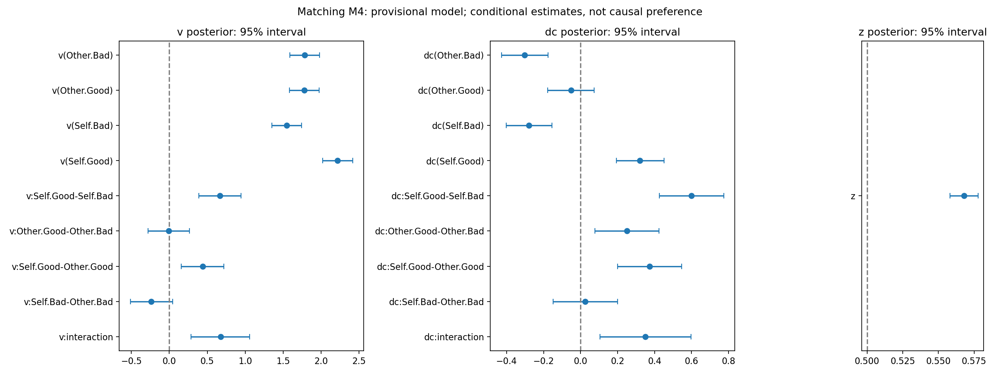
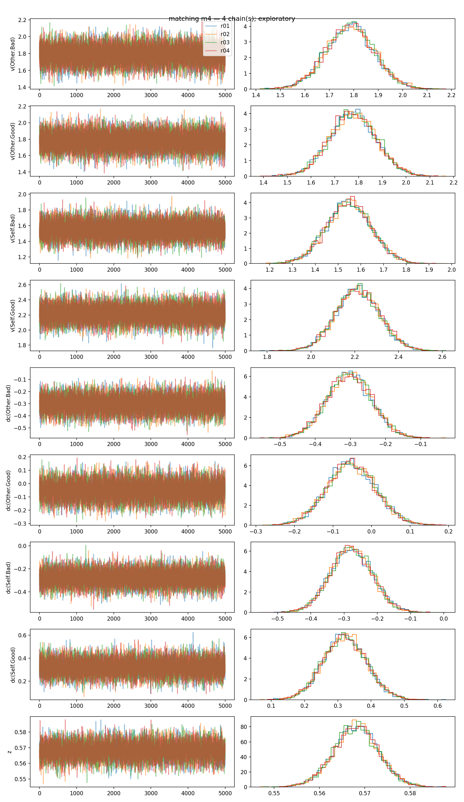
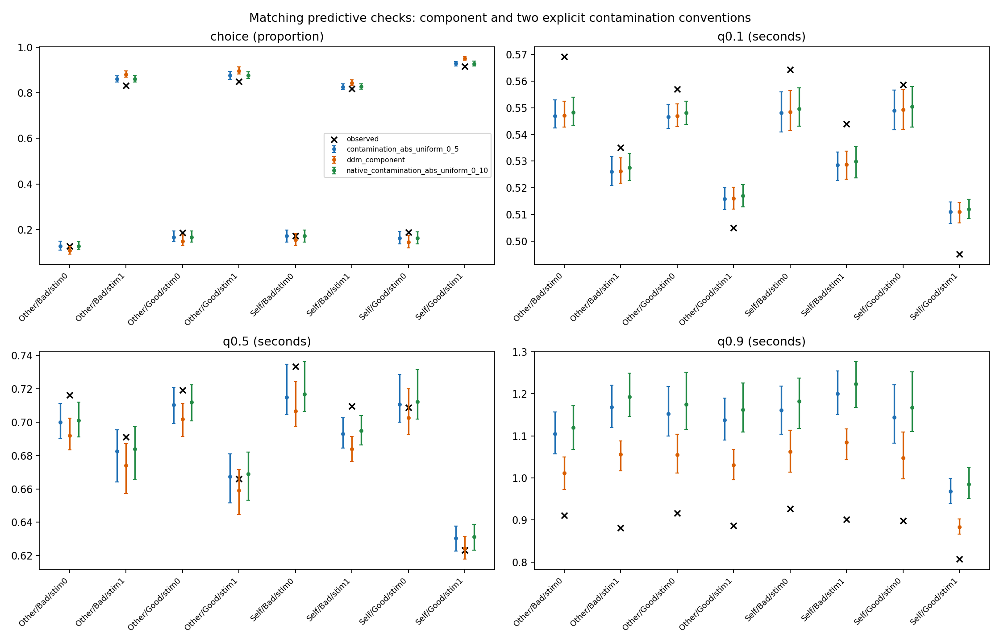

# Moral self-associations and perceptual decisions: HDDM reanalysis

[中文](README_zh.md) · [Full results and calculations](results.ipynb)

## Research purpose

Using the confirmatory data from Hu et al. (2020), this analysis examines whether good-self associations show faster evidence accumulation than bad-self and good-other associations, while distinguishing stimulus-related evidence from response bias.

## Data and experimental tasks

Data come from the [original study's public materials](https://github.com/hcp4715/moralSelf_ddm). Identity (Self, Other) and moral valence (Good, Bad) define four association conditions. The three tasks are fitted separately.

|Task|Judgment|Participants|Valid trials|
|---|---|---:|---:|
|Matching|Whether a shape and label match|42|24527|
|Identity|Whether a stimulus belongs to Self or Other|41|14493|
|Valence|Whether a stimulus belongs to Good or Bad|41|14431|

Inputs are stored in `Data/`. The main analysis retains positive reaction times, measured in seconds. One invalid keypress trial was excluded from Matching.

## Model specification

### Stimulus coding

The models use `HDDMStimCoding` with `split_param="v"`. `response` codes the actual choice and `stim` codes the stimulus category; response boundaries are not relabeled as correct and incorrect.

|Task|Upper boundary: response=1; category coded stim=1|Lower boundary: response=0; category coded stim=0|
|---|---|---|
|Matching|Match|Mismatch|
|Identity|Self|Other|
|Valence|Good|Bad|

Taking the upper boundary as the positive direction, signed drift is:

$$
\mu=(2\,\mathrm{stim}-1)v+dc.
$$

The two stimulus directions therefore share $v$ within each condition, with opposite signs; $dc$ enters with the same sign in both directions. $v$ is the stimulus-related drift component, rather than an overall tendency toward one response.

### Model parameters and psychological interpretation

|Parameter|Computational meaning|Interpretation in these tasks|
|---|---|---|
|$v$|Mean stimulus-related evidence change per unit time; its sign reverses with stimulus category|Evidence accumulation for match discrimination in Matching, Self/Other classification in Identity, and Good/Bad classification in Valence. Increasing positive $v$ supplies stronger evidence in the correct direction; condition differences do not directly measure preference.|
|$a$|Distance between the decision boundaries|A model-based measure of the evidence required to choose in each task. Holding other parameters constant, larger $a$ generally corresponds to more cautious decisions.|
|$t$|The component of reaction time outside evidence accumulation, in seconds|Combined time for processes such as sensory encoding and response execution in each task. These stages cannot be separated by this model; $t$ corresponds to the original study's nondecision time $t_0$.|
|$z$|Relative starting point between 0 and 1; the absolute starting point is $az$, with 0.5 centered|A response tendency before accumulation begins. $z>0.5$ favors Match, Self, and Good in the respective tasks. The internal `z_trans` parameter is inverse-logit transformed before interpretation as $z$.|
|$dc$|An additive shift in signed drift, with the same sign for both stimulus directions|A directional bias during accumulation. $dc>0$ shifts drift toward Match, Self, and Good, respectively. It may also absorb asymmetric stimulus difficulty and cannot establish a causal preference on its own.|

Psychological interpretations depend on the model assumptions. $z$ changes the initial position, whereas $dc$ changes the mean direction of accumulation. A Match response bias in Matching is not a direct measure of good-self preference.

### Candidate models and fitting

All models estimate $a$, $t$, and $v$ hierarchically. $a$ and $t$ are shared across conditions within each task. The condition dependencies of $v$ and the five candidate models are listed below. “Shared” means shared across experimental conditions, not identical parameter values across participants.

|Task|Condition dependence of $v$|Stimulus directions sharing $v$|
|---|---|---|
|Matching|Identity × moral valence|Match / Mismatch|
|Identity|Moral valence|Self / Other|
|Valence|Identity|Good / Bad|

|Model|$z$|$dc$|
|---|---|---|
|M0|Fixed at 0.5|Fixed at 0|
|M1|Estimated, shared across conditions|Fixed at 0|
|M2|Fixed at 0.5|Estimated, shared across conditions|
|M3|Estimated, shared across conditions|Estimated, shared across conditions|
|M4|Estimated, shared across conditions|Same condition dependence as $v$|

Fits use HDDM informative priors (`informative=True`) and a fixed outlier-mixture probability of 0.05. Each screening fit used one chain with 10000 iterations, 5000 discarded, and `thin=1`. DIC, traces, and predictive checks informed provisional selection of M4 for each task, followed by three additional chains with the same settings. Identity and Valence were subsequently refitted with four entirely new chains, each with 60000 iterations and 30000 discarded; these were not pooled with the original chains. Single-chain screening cannot establish convergence, and M4 is not a conclusively superior model.

## Results

### Matching

Under M4, drift rate was higher for good-self than for bad-self and good-other. The Good−Bad difference was also larger for Self than for Other.

|Drift-rate contrast|Mean difference|95% credible interval|
|---|---:|---|
|Good-self − Bad-self|0.666|[0.387, 0.942]|
|Good-self − Good-other|0.438|[0.160, 0.719]|
|Good-other − Bad-other|−0.009|[−0.278, 0.267]|
|Identity × moral valence interaction¹|0.675|[0.284, 1.059]|

¹ (Good-self−Bad-self)−(Good-other−Bad-other). Intervals are 95% equal-tailed posterior credible intervals.

$z$ was 0.568 [0.558, 0.578], indicating a starting-point bias toward Match. The good-self minus bad-self $dc$ contrast was 0.600 [0.427, 0.774]. These biases describe response tendencies in matching judgments.



**Figure 1. Matching parameter estimates and condition contrasts.** Points are posterior means and lines are 95% credible intervals; $v$ denotes stimulus-related drift, $dc$ drift bias, and $z$ the relative starting point.

### Convergence diagnostics

Matching M4 passed the four-chain diagnostics. Identity and Valence M4 remained nonconverged after independent long-chain refits, so their parameter estimates are not interpreted.

|Task|Maximum Rhat|Minimum bulk ESS|Minimum tail ESS|Assessment|
|---|---:|---:|---:|---|
|Matching|1.0022|917|472|Passed|
|Identity (long refit)|1.3076|10|17|Not passed|
|Valence (long refit)|1.5282|7|27|Not passed|

Criteria were rank-normalized Rhat<1.01 and bulk/tail ESS≥400, supplemented by trace inspection. Rhat assesses agreement between chains; ESS measures effective sampling information. M0–M3 have only single-chain screening results, which cannot establish four-chain convergence.



**Figure 2. Matching traces and parameter distributions.** Colors distinguish chains; the left column shows sampling traces and the right column shows parameter distributions.

## Model checks and limitations

**Posterior predictive checks (PPC).** The model overpredicts the slow-RT tail. The experiment used a response window of approximately 0.9–1.2 seconds, whereas predictions were not subject to the same window. Trial-specific windows have not been recovered, leaving their contribution to the discrepancy unresolved.



**Figure 3. Observed and predicted Matching outcomes.** Black crosses show observations; colored points and intervals show predictive means and 95% intervals of predictive statistics. Panels show choice proportions and RT quantiles. Two additional outlier-generation conventions assess predictive sensitivity; neither exactly matches the full fitted outlier likelihood.

**Sensitivity analysis.** Excluding RT≤0.2 seconds changed the main group estimates little, but one individual parameter had tail ESS=342, below the criterion.

**Parameter recovery.** All four simulated scenarios contained convergence failures, leaving recovery performance unresolved. One simulated dataset per scenario is also insufficient to assess repeated-sampling interval coverage.

The Matching results are consistent in direction with a good-self processing advantage, but fit and recovery checks limit their interpretation. Sharing $v$ across stimulus directions and $t$ across conditions, adding $dc$, and changing the outlier specification produce estimands that differ from the 2020 model; parameter values are not directly comparable. Nonconvergence in Identity and Valence also prevents assessment of the original cross-task conclusion.

## Files and reproduction

`Data/` contains task inputs, `Scripts/hddm/` contains shared calculations and task-specific entry points, and `Output/` contains result tables and figures. Matching has 7 task-level files; Identity and Valence have 5 each. The [notebook](results.ipynb) reads public results only. The [output manifest](Scripts/hddm/output_manifest.json) lists 97 public result files and their producers.

Fitting uses dockerHDDM (HDDM 1.0.1RC). The fixed image and sampling settings are recorded in the [task configuration](Scripts/hddm/matching/matching_config.json); Identity and Valence have corresponding configurations in their own directories. Within that environment, run from this directory:

```sh
python Scripts/hddm/reproduce.py plan --output Output_new
python Scripts/hddm/reproduce.py run --output Output_new --workers 2
python Scripts/hddm/reproduce.py verify --output Output_new
```

`plan` displays the schedule; `run` executes the full analysis. A complete run requires the adjacent `01_reproduction_2020/Data` and an output directory that does not yet exist. Tasks execute sequentially. `--workers` accepts 1–4, defaulting to 1; the requested values 5/9 in the configurations do not control current concurrency. Recovery uses at most two workers, and preflight runs sequentially. Reduce concurrency when memory is limited.

Each task's `*_run.py` supports single-chain `fit` and batch phases. The `compare`, `diagnostics`, and `ppc` operations in `*_analyze.py` can run independently; see `--help` for options. To check existing public files, run `python Scripts/hddm/reproduce.py verify --output Output`, which requires only the Python standard library. It does not recompute statistics or assess convergence. The notebook requires pandas and IPython.

Databases and draw-level posterior samples are not distributed. Postprocessing has been checked using saved draws, but the current complete fitting pipeline has not been rerun from scratch. New fits should use a separate directory and must not be pooled with chains whose settings or code fingerprints differ.

## References

- [Hu et al. (2020): original moral-self study](https://doi.org/10.1525/collabra.301)
- [Pan et al. (2025): dockerHDDM](https://doi.org/10.1177/25152459241298700)
- [Stimulus-coding code](https://github.com/Chuan-Peng-Lab/ddm_stim_coding_posts)
