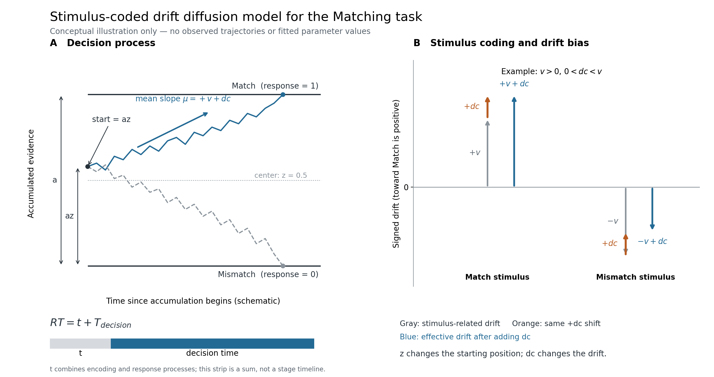

> **历史归档 / Historical M0–M4 exploration.** This is not the current H0–H3 analysis. [Current status / 当前状态](README_zh.md). Original scientific text retained below.

# Part II: Moral Self-Associations and Perceptual Decision-Making: HDDM Reanalysis

English · [中文](README_zh.md) · [Project Home](../README.md) · [Results Notebook](results.ipynb)

## Research Aim

This analysis uses the confirmatory data from Hu et al. (2020) to examine how moral self-associations influence perceptual decision-making, using a stimulus-coded hierarchical drift diffusion model (HDDM).

The Matching task examines differences in evidence accumulation between Good-self and other association conditions. The Identity and Valence tasks examine the effects of moral valence and identity information on classification decisions, respectively. The model distinguishes stimulus-related evidence accumulation from starting-point and drift biases.

Because the model parameterization differs from that of the original study, this is an exploratory reanalysis rather than a direct numerical replication of the original model.

## Data and Experimental Tasks

Data were obtained from the [original study's public repository](https://github.com/hcp4715/moralSelf_ddm). Identity (Self, Other) and moral valence (Good, Bad) define four association conditions. The three tasks were modeled separately.

| Task     | Judgment                                            | Participants | Valid trials |
| -------- | --------------------------------------------------- | ------------ | ------------ |
| Matching | Whether a shape and label match                     | 42           | 24,527       |
| Identity | Whether a stimulus is associated with Self or Other | 41           | 14,493       |
| Valence  | Whether a stimulus is associated with Good or Bad   | 41           | 14,431       |

Model inputs are stored in `Data/`. The primary analysis retained positive reaction times in seconds. One invalid keypress trial was excluded from Matching.

## Model Specification

### Stimulus Coding

The models use `HDDMStimCoding` with `split_param="v"`.

The `stim` variable codes the correct response direction associated with the stimulus, whereas `response` codes the participant's actual choice. A trial is correct when these values agree and incorrect when they differ. Unlike accuracy coding, stimulus coding preserves the response categories associated with the decision boundaries.

| Task     | Upper boundary (response = 1) | Lower boundary (response = 0) |
| -------- | ----------------------------- | ----------------------------- |
| Matching | Match                         | Mismatch                      |
| Identity | Self                          | Other                         |
| Valence  | Good                          | Bad                           |

Here, `stim = 1` indicates that the correct response corresponds to the upper boundary, and `stim = 0` indicates the lower boundary.

Taking the upper boundary as the positive direction, signed drift is defined as:

$$
\mu=(2\,\mathrm{stim}-1)v+dc
$$

The two stimulus directions share the same drift magnitude $`v`$ within each condition but have opposite signs. The drift criterion $`dc`$ is added with the same sign in both directions. Thus, $`v`$ represents stimulus-related evidence accumulation rather than an overall tendency toward a particular response.

### Model Parameters and Psychological Interpretation

| Parameter                   | Computational meaning                                                   | Interpretation in the present tasks                                                                                                                                                                                          |
| --------------------------- | ----------------------------------------------------------------------- | ---------------------------------------------------------------------------------------------------------------------------------------------------------------------------------------------------------------------------- |
| **$`v`$** Drift rate          | Mean rate of stimulus-related evidence accumulation                     | Reflects evidence accumulation for match discrimination in Matching, Self/Other classification in Identity, and Good/Bad classification in Valence. Larger positive $`v`$ indicates stronger evidence in the correct direction |
| **$`a`$** Boundary separation | Distance between the two decision boundaries                            | Represents the amount of evidence required before making a decision. Larger $`a`$ generally corresponds to more cautious decisions when other parameters are held constant                                                     |
| **$`t`$** Non-decision time   | Reaction-time component outside evidence accumulation, in seconds       | Includes processes such as sensory encoding, motor preparation, and response execution. These components cannot be separated by the present model and correspond to the original study's non-decision time $`t_0`$             |
| **$`z`$** Starting point      | Relative initial position of evidence accumulation, ranging from 0 to 1 | Represents a response bias before accumulation begins; $`z=0.5`$ indicates a centered starting point                                                                                                                           |
| **$`dc`$** Drift criterion    | Directional offset added to stimulus-related drift                      | Represents a response bias during evidence accumulation and may also capture asymmetries in stimulus difficulty                                                                                                              |

The drift rate $`v`$ is the primary parameter used to examine the Good-self processing advantage. In Matching, separate drift magnitude parameters are estimated for the four association conditions. Larger $`v`$ indicates more efficient evidence accumulation under the model but does not identify the specific perceptual or neural processing stage responsible for the difference.

The starting point $`z`$ represents a response tendency before accumulation. Under the current coding scheme, $`z>0.5`$ indicates an initial position closer to the Match, Self, or Good boundary in the respective tasks. A Match response bias in Matching cannot be interpreted directly as a Good-self preference.

The drift criterion $`dc`$ represents a directional offset during accumulation. Positive $`dc`$ shifts drift toward the Match, Self, or Good boundary, whereas negative values shift drift toward the opposite boundary.

The parameters $`z`$ and $`dc`$ act on different components of the decision process: the initial position and the mean direction of accumulation, respectively. Their empirical separability remains subject to parameter-recovery validation.

The relative starting point is $`z`$ and the absolute position is $`az`$; the internal sampling parameter `z_trans` is inverse-logit transformed before interpretation as $`z`$.



**Figure 1. Simulated evidence-accumulation paths and effective drift under Matching M4.**

A: Match and Mismatch stimulus paths simulated at the Good-self group posterior means. B: Effective drift in four association conditions, with 95% equal-tailed credible intervals computed from paired v and dc posterior draws. Simulated paths are not measured evidence trajectories or a full posterior predictive check.

### Candidate Models and Fitting

All models estimate $`a`$, $`t`$, and $`v`$ hierarchically. The parameters $`a`$ and $`t`$ are shared across experimental conditions within each task, whereas $`v`$ varies according to the task-specific condition structure. Sharing a parameter across conditions does not imply identical parameter values across participants.

| Task     | Condition dependence of $`v`$ | Stimulus directions sharing drift magnitude |
| -------- | --------------------------- | ------------------------------------------- |
| Matching | Identity × Valence          | Match / Mismatch                            |
| Identity | Valence                     | Self / Other                                |
| Valence  | Identity                    | Good / Bad                                  |

Five candidate models were fitted separately for each task.

| Model | Starting point $`z`$                  | Drift criterion $`dc`$                             |
| ----- | ----------------------------------- | ------------------------------------------------ |
| M0    | Fixed at 0.5                        | Fixed at 0                                       |
| M1    | Estimated, shared across conditions | Fixed at 0                                       |
| M2    | Fixed at 0.5                        | Estimated, shared across conditions              |
| M3    | Estimated, shared across conditions | Estimated, shared across conditions              |
| M4    | Estimated, shared across conditions | Varies with the relevant experimental conditions |

Models used HDDM informative priors (`informative=True`) and a fixed outlier-mixture probability of 0.05.

Each candidate model was initially fitted with one MCMC chain of 10,000 iterations, including 5,000 burn-in iterations, with `thin=1`. DIC, sampling traces, and preliminary posterior predictive measures informed the provisional selection of M4, followed by three additional chains with the same settings.

Identity and Valence were subsequently refitted using four independent longer chains, each with 60,000 iterations and 30,000 burn-in iterations. These chains were not pooled with the original fits.

Model selection remains uncertain because the initial screening used only one chain per candidate model.

## Results

### Matching

Under candidate M4, the estimated drift magnitude was higher for Good-self than for Bad-self and Good-other. The Good−Bad difference was also larger for Self than for Other.

| Drift-magnitude contrast       | Posterior mean difference | 95% credible interval |
| ------------------------------ | ------------------------- | --------------------- |
| Good-self − Bad-self           | 0.666                     | [0.387, 0.942]        |
| Good-self − Good-other         | 0.438                     | [0.160, 0.719]        |
| Good-other − Bad-other         | −0.009                    | [−0.278, 0.267]       |
| Identity × Valence interaction | 0.675                     | [0.284, 1.059]        |

The interaction contrast is defined as:

$$
(v_{GS}-v_{BS})-(v_{GO}-v_{BO})
$$

Intervals are 95% equal-tailed posterior credible intervals.

The posterior mean of $`z`$ was 0.568, with a 95% credible interval of [0.558, 0.578], indicating a starting-point bias toward the Match boundary.

The Good-self minus Bad-self contrast in $`dc`$ was 0.600 [0.427, 0.774], indicating a difference in drift bias toward the Match boundary between these conditions.

These estimates are conditional on the candidate M4 model and its parameter constraints.


**Figure 2. Parameter estimates and condition contrasts under Matching M4.**

Points represent posterior means, and intervals represent 95% credible intervals.
### Convergence Diagnostics

| Task                     | Maximum R-hat | Minimum bulk ESS | Minimum tail ESS | Assessment |
| ------------------------ | ------------- | ---------------- | ---------------- | ---------- |
| Matching M4              | 1.0022        | 917              | 472              | Passed     |
| Identity M4 (long refit) | 1.3076        | 10               | 17               | Failed     |
| Valence M4 (long refit)  | 1.5282        | 7                | 27               | Failed     |

The convergence criteria were rank-normalized R-hat < 1.01, bulk ESS ≥ 400, and tail ESS ≥ 400, supplemented by visual inspection of sampling traces.

Matching M4 met the predefined four-chain convergence criteria. Identity and Valence showed substantial convergence problems after independent long-chain refitting; their parameter estimates are therefore not interpreted inferentially.

M0–M3 were evaluated only during single-chain screening, which cannot establish multichain convergence.


**Figure 3. Sampling traces and posterior distributions for Matching M4.**
## Model Checks and Limitations

### Posterior Predictive Checks (PPC)

Matching M4 overpredicted the slow-reaction-time tail. The original experiment imposed response windows of approximately 0.9–1.2 seconds, whereas the current predictions did not apply the corresponding trial-specific windows. The contribution of this discrepancy remains unresolved.

Two supplementary outlier-generation conventions were also used for predictive sensitivity checks. Neither exactly matches the full outlier likelihood used during fitting.


**Figure 4. Observed and predicted choice proportions and reaction-time quantiles under Matching M4.**

Black crosses represent observed values; colored points and intervals represent posterior predictive statistics.
### Sensitivity Analysis

Excluding trials with RT ≤ 0.2 seconds produced little change in the main group-level estimates. However, one individual parameter had a tail ESS of 342, below the predefined threshold.

### Parameter Recovery

All four simulated parameter-recovery scenarios showed convergence problems, leaving recovery performance unresolved. Each scenario used only one simulated dataset, which is insufficient for assessing interval coverage across repeated samples.

### Interpretation

The Matching estimates are directionally consistent with a Good-self evidence-accumulation advantage, but their interpretation is limited by model selection, predictive fit, and parameter recovery.

The present analysis differs from the original study by sharing $`v`$ across stimulus directions, sharing $`t`$ across conditions, introducing $`dc`$, and using a different outlier specification. The resulting parameter estimates are therefore not directly comparable.

Nonconvergence in Identity and Valence prevents an assessment of the cross-task effects reported in the original study.

## Files and Reproducibility

| Directory or file        | Contents                                                                                 |
| ------------------------ | ---------------------------------------------------------------------------------------- |
| `Data/`                  | Model inputs for Matching, Identity, and Valence                                         |
| `Scripts/hddm/common.py` | Shared HDDM model construction, fitting, and analysis functions                          |
| `Scripts/hddm/matching/` | Matching model fitting, analysis, plotting, parameter recovery, and sensitivity analysis |
| `Scripts/hddm/identity/` | Identity model fitting, analysis, and plotting                                           |
| `Scripts/hddm/valence/`  | Valence model fitting, analysis, and plotting                                            |
| `Output/`                | Model comparisons, parameter estimates, diagnostics, and figures                         |
| `results.ipynb`          | Summary and presentation of saved analysis results                                       |

Public outputs and their sources are documented in [output_manifest.json](Scripts/hddm/output_manifest.json).

Fitting uses dockerHDDM (HDDM 1.0.1RC). The container image and sampling settings are specified in the task configuration.

From the `02_reanalysis_2026/` directory, inspect the reproduction plan:

```bash
python Scripts/hddm/reproduce.py plan --output Output_new
```

To run the full fitting pipeline in the configured HDDM environment:

```bash
python Scripts/hddm/reproduce.py run --output Output_new --workers 2
```

A complete run requires the adjacent `01_reproduction_2020/Data` directory and a new output directory that does not already exist. Tasks run sequentially, and `--workers` supports 1–4 concurrent jobs, defaulting to 1. Lower concurrency may be necessary on memory-constrained systems.

To verify the existing public output files:

```bash
python Scripts/hddm/reproduce.py verify --output Output
```

This command checks file integrity and basic structure without recomputing parameter estimates or assessing convergence.

The current complete fitting pipeline has not yet been rerun end-to-end after code reorganization. The repository provides model inputs, analysis code, and summarized results, but does not distribute full MCMC databases or draw-level posterior samples.

To rebuild Figure 1 from public summaries (requires NumPy and Matplotlib, without HDDM or local posterior databases):

```bash
python Scripts/hddm/matching/matching_plot.py --kind schematic --output Output --figures-output Figures_check
```

The figure and simulation metadata are written to `Figures_check/`, preserving the published outputs.

The effective-drift table is produced by `python Scripts/hddm/matching/matching_analyze.py diagnostics --effective-drift --output Output`, which requires posterior samples from the four formal chains and NumPy, pandas, and ArviZ; plotting reads public summaries only. The seed, time step, source hashes, and choices and RTs of simulated paths are recorded in `Output/hddm/matching/figures/matching_ddm_simulation.json`.

### Figure 1 Simulation Settings

Fixed parameters are a = 1.224, z = 0.568, t = 0.464 s, v = 2.214, and dc = 0.321. The first two paths per stimulus are shown without selection by outcome or appearance. Paths start at the product of the group means and stop at the first detected boundary contact. Time is measured from accumulation onset; RT adds t.

Paths approximate a unit-diffusion Wiener process using Euler–Maruyama steps ($`\Delta t=0.0001`$ s, seed `2026102301`), with interpolation within the final step to locate boundary contact. Panel A does not propagate posterior parameter uncertainty or between-participant variability. It illustrates only the DDM component, excluding the outlier mixture and experimental response windows, and is not a full posterior predictive check. The plug-in starting point $`\bar a\bar z`$ is not $`E[az]`$. Existing PPC and parameter-recovery limitations still apply.

## References

- [Hu et al. (2020), *Good me, bad me: Prioritization of the good-self during perceptual decision-making*](https://doi.org/10.1525/collabra.301)
- [Pan et al. (2025), dockerHDDM](https://doi.org/10.1177/25152459241298700)
- [HDDM documentation](https://hddm.readthedocs.io/en/latest/)
- [Stimulus-coding implementation](https://github.com/Chuan-Peng-Lab/ddm_stim_coding_posts)
- [Myers et al. (2022), A practical introduction to using the drift diffusion model](https://doi.org/10.3389/fpsyg.2022.1039172)
